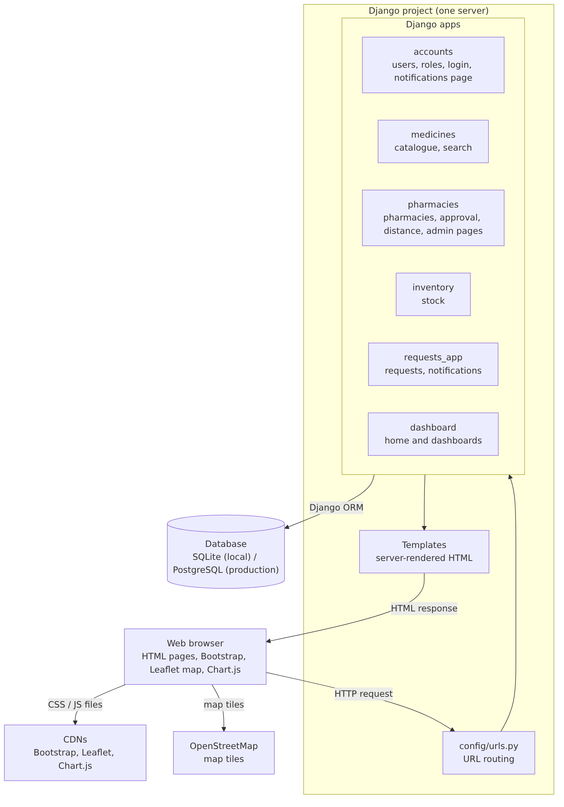
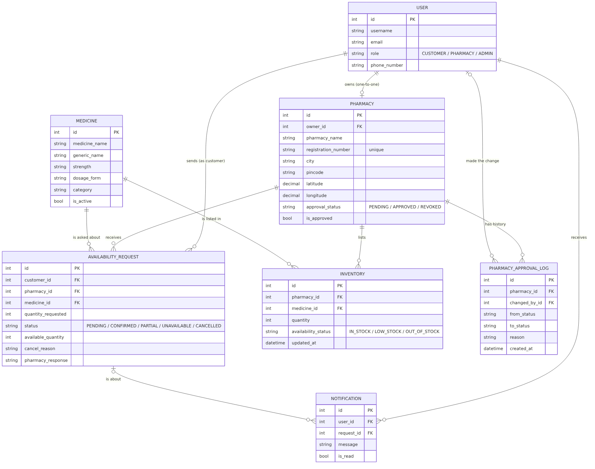

# Architecture

How MediFind is built: the parts, the database, who may open what, and the security controls.
Checked against the code on branch `fix/manual-testing` (2026-11-26).

## 1. The big picture

MediFind is one Django project (one program, one database) that renders HTML on the server.

- **Back end:** Python 3.11, Django 5.2.19 (exact versions in `requirements.txt`).
- **Database:** SQLite file `db.sqlite3` locally; PostgreSQL in production when `DATABASE_URL` is set.
- **Front end:** Django templates with Bootstrap 5.3.3, Bootstrap Icons, Leaflet 1.9.4 maps with
  OpenStreetMap tiles, and Chart.js 4.4.1, loaded from CDNs with SRI hashes (a checksum the browser
  verifies). No React and no AJAX: every filter reloads the page.
- **Production server:** Gunicorn runs the app; WhiteNoise serves the CSS/JS files.

## 2. Folder map

| Folder / file | What is in it |
|---|---|
| `config/` | `settings.py` (all settings, read from environment variables) and `urls.py` |
| `accounts/` | `User` model with a `role`, registration, login/logout, profile, notifications page, role decorators, validators |
| `medicines/` | `Medicine` catalogue, public search and detail pages, admin catalogue pages, the `seed_data` command |
| `pharmacies/` | `Pharmacy` and `PharmacyApprovalLog` models, directory and detail pages, profile edit, admin pages, distance helpers |
| `inventory/` | `Inventory` (stock of one medicine at one pharmacy) and the owner's stock pages |
| `requests_app/` | `AvailabilityRequest` and `Notification` models; create, list, inbox, respond, cancel |
| `dashboard/` | Home page and the three role dashboards (no models) |
| `templates/` | HTML templates, one folder per app; `base.html` is the shared layout; `404.html`, `500.html` |
| `static/` | `css/styles.css`, `js/map_popup.js` (safe map popups), images, one patched Django admin script |
| `tests/`, `e2e/` | Unit tests and browser tests (see [TESTING.md](TESTING.md)) |
| `scripts/` | `reset_demo.sh`, `take_screenshots.py`, `check_doc_links.py` |
| `render.yaml`, `build.sh` | Deployment (see [DEPLOYMENT.md](DEPLOYMENT.md)) |
| `.github/workflows/ci.yml`, `ruff.toml` | CI and lint settings |

Each app uses the same files: `models.py` (tables), `urls.py` (URL → view), `views.py` (reads the
request, checks the role, calls a service, picks a template), `services.py` (business rules and
queries), `forms.py` (input checks) and `admin.py` (Django admin). The admin list pages and the
customer request list query the database directly in the view.

## 3. How one request travels (searching "Dolo")

1. The browser asks for `GET /medicines/search/?q=Dolo&city=Hyderabad`.
2. `config/urls.py` → `medicines/urls.py` → `search_medicines_view` (`medicines/views.py:14`).
   If the city box holds only digits, it is used as a pincode.
3. The service `search_medicine_inventory()` (`medicines/services.py:30`) starts from stock rows of
   **approved** pharmacies and **active** medicines, applies the search and filters, adds a stock rank
   (In Stock 0, Low 1, Out 2) and, with the user's location, a distance computed in the database. It
   orders and paginates in the database (10 per page) and builds map pins for that page.
4. The view renders `templates/medicines/search.html`. Map data goes to JavaScript with `json_script`;
   popups are built with `textContent` in `static/js/map_popup.js`, so text typed by a pharmacy is never
   run as HTML.
5. Two context processors add the unread notification count and `show_demo_logins` to every page.

A POST works the same way, but the view first validates a form and then redirects with a message.

**Main services:** `register_customer` / `register_pharmacy` (accounts); `search_medicine_inventory`,
`get_medicine_detail_data` (medicines); `calculate_haversine_distance`, `haversine_expression`,
`discover_nearby_pharmacies`, `set_pharmacy_approval`, `apply_pharmacy_profile_update` (pharmacies);
`add_or_update_inventory` (inventory); `create_availability_inquiry`, `respond_to_availability_inquiry`,
`cancel_availability_inquiry`, `cancel_pending_requests_for_medicine` (requests_app); one
`get_*_dashboard_metrics` per role (dashboard). Dashboard and inbox counts use one `aggregate()` query
with `Count(..., filter=Q(...))`.

## 4. Distance and maps

- **Haversine formula:** the straight-line ("great circle") distance between two latitude/longitude
  points on a sphere of radius 6371 km. It is not road distance.
- `calculate_haversine_distance()` (`pharmacies/services.py:37`) is the Python version.
  `haversine_expression()` (`pharmacies/services.py:93`) builds the same formula as a database
  expression, so the radius filter, sorting and pagination run in the database, after a cheap
  latitude/longitude box (`bounding_box()`).
- The user's location comes from the browser (HTML5 Geolocation) only after the user allows it. It is
  sent as `lat`/`lng` in the URL and is never stored.
- OpenStreetMap's tile policy needs a Referer, so `SECURE_REFERRER_POLICY` is
  `strict-origin-when-cross-origin`, every `L.tileLayer` sets the same `referrerPolicy`, and every map
  shows "© OpenStreetMap contributors".

## 5. Database

Source: [diagrams/er_diagram.mmd](diagrams/er_diagram.mmd). Seven models, 19 migrations, 15 named
indexes. Django's ORM writes the SQL; there is no raw SQL. Times are stored in UTC and shown in
Asia/Kolkata time.

| Model | Key fields and rules |
|---|---|
| **User** (`accounts`) | Django's user plus `email` (unique), `role` (`CUSTOMER` / `PHARMACY` / `ADMIN`), `phone_number` |
| **Pharmacy** | `owner` one-to-one to User; `registration_number` unique; `city`, `pincode` (6 digits, not starting with 0); optional `latitude`/`longitude`; `approval_status` (`PENDING` / `APPROVED` / `REVOKED`); `is_approved` kept in sync by `save()` |
| **PharmacyApprovalLog** | one row per approval change: pharmacy, from/to status, `changed_by` (SET_NULL), optional `reason` (max 500), time |
| **Medicine** | name, generic name, strength, dosage form, category, `is_active` (False = archived). Name + strength (ignoring case) + form are unique |
| **Inventory** | pharmacy + medicine (unique together), `quantity`, `availability_status` computed in `save()` (>10 In Stock, 1–10 Low, 0 Out), `updated_at` (drives freshness) |
| **AvailabilityRequest** | customer, pharmacy and medicine (pharmacy and medicine are PROTECT, so history is kept); `quantity_requested` (1–1000); `status` (`PENDING` / `CONFIRMED` / `PARTIAL` / `UNAVAILABLE` / `CANCELLED`); `available_quantity` (only for PARTIAL, 1 to requested − 1); `cancel_reason` (`CUSTOMER` / `STOCK_REMOVED` / `PHARMACY_REVOKED`); messages up to 1000 characters |
| **Notification** | user, message, `is_read`, optional `request` link (so the owner's "new request" notification is marked read when the request is opened or answered) |

**Indexes:** besides single indexed columns, 15 named indexes cover the common filters, for example
(pharmacy, availability_status), (customer, status), (pharmacy, -created_at) and (user, is_read).

**Safe changes under load:**
- Registration and approve/revoke run in one transaction; approve/revoke locks the pharmacy row and
  writes the history row in the same transaction.
- Answering or cancelling a request is a conditional `UPDATE … WHERE status='PENDING'`, so only the
  first change wins. Creating a request locks the customer row, so two quick submits cannot both pass
  the duplicate and rate-limit checks.

**Migrations (19):** `accounts` 0001–0003, `inventory` 0001–0003, `medicines` 0001–0003, `pharmacies`
0001–0006, `requests_app` 0001–0004. Apply with `python manage.py migrate`; check with
`python manage.py makemigrations --check`.

## 6. Roles and permissions

`User.role` is `CUSTOMER` (default), `PHARMACY` or `ADMIN`. An **admin** is role ADMIN or a superuser;
`is_staff` alone only opens Django admin (`/admin/`).

| Decorator (`accounts/decorators.py`) | Allows | Not logged in | Wrong role |
|---|---|---|---|
| `@customer_required` | customers and admins | redirect to login with `?next=` | redirect to own dashboard with a message |
| `@pharmacy_required` | pharmacy owners and admins | same | same |
| `@admin_required` | admins | same | same |
| `@require_POST` | POST only | – | GET → 405 |

Every query for private data also includes the owner (for example
`get_object_or_404(Inventory, pk=pk, pharmacy=<own pharmacy>)`), so another user's row gives **404**.

| Area | URLs | Who |
|---|---|---|
| Public | `/`, `/medicines/search/`, `/medicines/<id>/`, `/pharmacies/`, `/pharmacies/<id>/` | everyone; a non-approved pharmacy only for its owner and admins; licence number and approval history only for owner and admins |
| Accounts | register, login (visitors); logout (POST); profile, notifications, password change; password reset | logged-in users, except register/login/reset |
| Customer | `/requests/create/<pharmacy>/<medicine>/` (customers only), `/requests/my-requests/`, `/requests/<id>/cancel/` (POST, PENDING only) | customers (admins can view the list) |
| Pharmacy | `/inventory/` (+ add, edit, delete), `/requests/pharmacy-inbox/`, `/requests/<id>/respond/`, `/pharmacies/profile/edit/` | pharmacy owners; a revoked pharmacy cannot change stock or answer |
| Admin | `/dashboard/admin-portal/`, `/pharmacies/manage/list/`, `/pharmacies/manage/<id>/toggle-approval/` (POST), `/pharmacies/manage/users/`, `/pharmacies/manage/requests/`, `/medicines/manage/` (+ add, edit) | admins |
| Django admin | `/admin/` | `is_staff` users |

There are 40 app URLs; anything else shows the 404 page.

## 7. Security

No external penetration test has been done. The controls in the code:

- **Safe settings:** `DEBUG` is False unless set. Without DEBUG, the app refuses to start without a
  `SECRET_KEY`, and `ALLOWED_HOSTS` has no `*` default. With DEBUG off: HTTPS redirect, HSTS, secure
  cookies and `X-Frame-Options: DENY`. Always on: no-sniff, HTTP-only session cookie, the referrer policy
  above.
- **Passwords:** Django's PBKDF2 hashing and its four password validators (minimum 8 characters).
- **Login rate limit** (`accounts/views.py:78-152`): 5 failed logins per IP + username, or 20 per IP,
  give HTTP 429 for 15 minutes. Behind Render's proxy the client IP comes from `X-Forwarded-For`
  (`TRUSTED_PROXY_COUNT=1`). The counter lives in local memory, so it is per server process.
- **CSRF and POST-only actions:** logout, mark read, cancel request, approve/revoke and stock delete only
  change data on POST, with a CSRF token. `?next=` after login is followed only to this site.
- **Input limits:** quantity 1–1000, messages up to 1000 characters, 6-digit pincode, phone 7–15 digits,
  coordinate ranges, at most 10 requests per customer per hour, no duplicate pending request.
- **SQL injection:** ORM only. **XSS:** templates auto-escape (no `|safe`), data for JavaScript goes
  through `json_script`, map popups use `textContent`.
- **Data exposure:** demo logins only with DEBUG on; `seed_data` refuses to run with DEBUG off; licence
  numbers and approval history only for owner and admins; generic error messages and custom 404/500 pages.
- **Known gaps:** per-process rate limit, no Content-Security-Policy header, no two-factor login, and
  stock is self-reported.

## 8. Where do I find …?

| I want … | Look in |
|---|---|
| Stock status rule | `Inventory.save()`, `inventory/models.py:52` |
| Freshness rule (24h / 48h) | `inventory/models.py:66-99` |
| Search order | `STOCK_RANK`, `medicines/services.py:22` |
| Approve / revoke and history | `set_pharmacy_approval()`, `pharmacies/services.py:290`; `PharmacyApprovalLog`, `pharmacies/models.py:134` |
| Re-approval after a profile edit | `apply_pharmacy_profile_update()`, `pharmacies/services.py:346` |
| Request rules | `create_availability_inquiry()`, `requests_app/services.py:26` |
| "Answered once" and partial answers | `respond_to_availability_inquiry()`, `requests_app/services.py:114` |
| Cancel when stock is deleted | `inventory_delete_view()`, `inventory/views.py:150` |
| Settings and their defaults | `config/settings.py` and [DEPLOYMENT.md](DEPLOYMENT.md) |
| Demo data | `medicines/management/commands/seed_data.py` |
