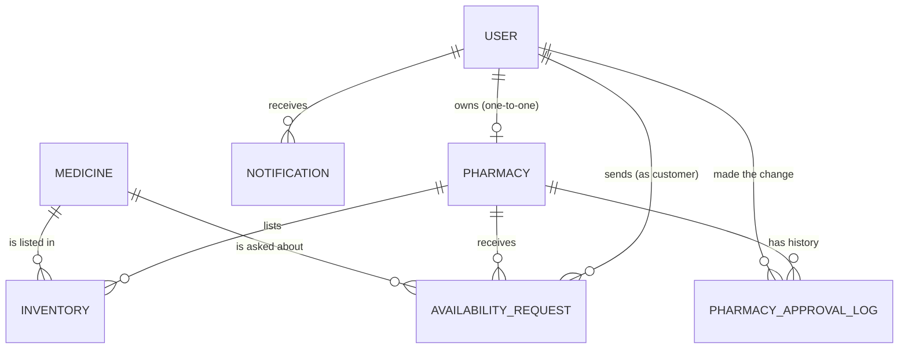

# Database

**Purpose:** The tables (models), their fields, relations, constraints and indexes, and how to rebuild the local database.
**Who it is for:** Developers changing models or queries, and examiners asking about the data design.
**Last verified:** 2026-11-22 against commit `513e68f` (7 models, 18 migrations, 15 named indexes).

Django "models" are Python classes; each one is a database table. Django's ORM (object-relational mapper)
turns Python queries into SQL, so the code has no raw SQL. Locally the database is the SQLite file
`db.sqlite3`; in production it is PostgreSQL (chosen by `DATABASE_URL`, see `config/settings.py`).
Times are stored in UTC (`USE_TZ = True`) and shown in Asia/Kolkata time.

## 1. Diagram



## 2. Models

### User (`accounts/models.py`, table `accounts_user`)
Extends Django's `AbstractUser` (username, password hash, first/last name, `is_staff`, `is_superuser`,
`is_active`, `date_joined`, …). Set as `AUTH_USER_MODEL = 'accounts.User'`.

| Field | Type and rules |
|---|---|
| `email` | unique |
| `role` | `CUSTOMER` (default) / `PHARMACY` / `ADMIN`, indexed |
| `phone_number` | up to 20 characters, optional, phone validator (7–15 digits) |
| `created_at` | set on create |

### Pharmacy (`pharmacies/models.py`)

| Field | Type and rules |
|---|---|
| `owner` | **OneToOneField** to User, `related_name='pharmacy'`, delete owner → delete pharmacy (CASCADE) |
| `pharmacy_name` | up to 200, indexed |
| `registration_number` | licence number, **unique**, indexed |
| `address` | text |
| `city` | indexed; `state` |
| `pincode` | indexed, validator: 6 digits, first digit 1–9 (`accounts/validators.py:29`) |
| `phone_number` | phone validator |
| `latitude`, `longitude` | Decimal(9, 6), optional, validators −90..90 and −180..180 |
| `approval_status` | `PENDING` (default) / `APPROVED` / `REVOKED`, indexed |
| `is_approved` | Boolean, indexed. Kept in sync by `save()`: True only when `approval_status` is APPROVED |
| `created_at` | set on create |

Public pages filter on `is_approved=True`; admin pages filter on `approval_status`.

### PharmacyApprovalLog (`pharmacies/models.py`)
One row per approval status change: approve, revoke, and "back to Pending" after an owner edits a
sensitive field.

| Field | Type and rules |
|---|---|
| `pharmacy` | FK to Pharmacy, CASCADE, `related_name='approval_logs'` |
| `from_status`, `to_status` | `PENDING` / `APPROVED` / `REVOKED` |
| `changed_by` | FK to User, SET_NULL (the history stays if the user is deleted) |
| `reason` | up to 500 characters, optional (admin's reason, or "Owner changed address, …") |
| `created_at` | indexed; newest first |

### Medicine (`medicines/models.py`)

| Field | Type and rules |
|---|---|
| `medicine_name`, `generic_name` | up to 200, indexed |
| `strength` | for example "650mg" |
| `dosage_form` | one of 8 choices (Tablet, Capsule, Syrup, …), indexed |
| `category` | one of 11 choices, indexed |
| `description` | optional text |
| `is_active` | default True; False = archived (hidden from public pages and new stock/requests), indexed |
| `created_at` | set on create |

Constraint `unique_medicine_name_strength_form`: name + strength (both ignoring case) + dosage form must be unique.

### Inventory (`inventory/models.py`)
One row = one medicine at one pharmacy.

| Field | Type and rules |
|---|---|
| `pharmacy` | FK to Pharmacy, CASCADE, `related_name='inventories'` |
| `medicine` | FK to Medicine, CASCADE |
| `quantity` | positive integer (0 or more) |
| `availability_status` | `IN_STOCK` / `LOW_STOCK` / `OUT_OF_STOCK`, **computed in `save()`** from quantity (>10, 1–10, 0) |
| `updated_at` | set on every save; drives the freshness wording |

`unique_together = ('pharmacy', 'medicine')`: a pharmacy lists each medicine once.

### AvailabilityRequest (`requests_app/models.py`)

| Field | Type and rules |
|---|---|
| `customer` | FK to User, CASCADE |
| `pharmacy` | FK to Pharmacy, **PROTECT** (a pharmacy with requests cannot be deleted, so request history is kept) |
| `medicine` | FK to Medicine, **PROTECT** |
| `quantity_requested` | positive integer, at least 1 (the form also caps it at 1000) |
| `request_message`, `pharmacy_response` | optional text (forms cap them at 1000 characters) |
| `status` | `PENDING` (default) / `CONFIRMED` / `UNAVAILABLE` / `CANCELLED`, indexed |
| `created_at` (indexed), `updated_at` | timestamps |

### Notification (`requests_app/models.py`)

| Field | Type and rules |
|---|---|
| `user` | FK to User, CASCADE |
| `message` | text |
| `is_read` | default False, indexed |
| `created_at` | indexed |

## 3. Named indexes (15)

An index is a lookup structure that makes filtering and sorting on those columns faster.

| Model | Index | Columns |
|---|---|---|
| User | `user_role_joined_idx` | role, -date_joined |
| Medicine | `med_cat_name_idx` | category, medicine_name |
| Medicine | `med_dosage_cat_idx` | dosage_form, category |
| Pharmacy | `pharm_appr_city_idx` | is_approved, city |
| Pharmacy | `pharm_appr_pincode_idx` | is_approved, pincode |
| Pharmacy | `pharm_appr_created_idx` | is_approved, -created_at |
| Inventory | `inv_pharm_status_idx` | pharmacy, availability_status |
| Inventory | `inv_pharm_updated_idx` | pharmacy, -updated_at |
| Inventory | `inv_status_updated_idx` | availability_status, -updated_at |
| AvailabilityRequest | `req_cust_status_idx` | customer, status |
| AvailabilityRequest | `req_cust_created_idx` | customer, -created_at |
| AvailabilityRequest | `req_pharm_status_idx` | pharmacy, status |
| AvailabilityRequest | `req_pharm_created_idx` | pharmacy, -created_at |
| Notification | `notif_user_read_idx` | user, is_read |
| Notification | `notif_user_created_idx` | user, -created_at |

Single columns marked "indexed" above have their own index as well (`db_index=True`).

## 4. Transactions and race conditions

- Registration of a pharmacy (user + pharmacy + notification) and of a customer (user + notification)
  runs in one transaction (`transaction.atomic()`), so a failure saves nothing.
- Approve/revoke locks the pharmacy row (`select_for_update()`) and writes the history row in the same transaction.
- Deleting a stock row and cancelling its pending requests happen in one transaction.
- Answering or cancelling a request uses a conditional `UPDATE … WHERE status='PENDING'`, so only the
  first change wins.
- Creating a request locks the customer row so two quick submits cannot both pass the duplicate and
  rate-limit checks.

## 5. Migrations (17)

`accounts` 0001–0003, `inventory` 0001–0003, `medicines` 0001–0003, `pharmacies` 0001–0006,
`requests_app` 0001–0003. Notable ones: `pharmacies.0003_pharmacy_approval_status` (adds the status and
fills it from `is_approved`), `pharmacies.0004_…` (owner becomes one-to-one, coordinate validators),
`pharmacies.0005_pharmacy_pincode_validator`, `pharmacies.0006_pharmacyapprovallog` (approval history),
`medicines.0003_medicine_is_active_and_more` (archive flag
and unique constraint), `requests_app.0003_availabilityrequest_protect_fks`.

Apply them with `python manage.py migrate` (`build.sh` does this on deploy). Check that models and
migrations match with `python manage.py makemigrations --check`.

## 6. Rebuilding the local database

`db.sqlite3` is ignored by git. To start clean, keep a backup instead of deleting it:

```bash
mv db.sqlite3 db.sqlite3.bak
python manage.py migrate
python manage.py seed_data      # needs DEBUG=True
```

Production backups are covered in [PRODUCTION_DEPLOYMENT_GUIDE.md](PRODUCTION_DEPLOYMENT_GUIDE.md).
