# MediFind: A Web Application to Find Medicines at Nearby Pharmacies

**Draft of the final-year project report.** Places marked **[TODO]** need your own details. Follow
your university's template for the title page, certificate, declaration, acknowledgement, page numbers
and reference style.

- Student: [TODO name, roll number]
- Guide: [TODO guide name, designation]
- Department / College / University: [TODO]
- Academic year: [TODO]

---

## Abstract

Patients often visit several pharmacies, or phone them one by one, to find a medicine. This wastes
time, especially when the need is urgent. MediFind is a web application in which approved pharmacies
publish what they have in stock, and anyone can search for a medicine and see which nearby pharmacy
reports having it, how much, and how old that report is. Customers can send an availability request,
and the pharmacy answers once: available, partially available (with the number of units) or
unavailable. An administrator approves pharmacies before they become public and keeps a history of
every approval change.

The system is built with Python and the Django web framework, uses SQLite locally and PostgreSQL in
production, and shows pharmacies on OpenStreetMap maps with Leaflet. Distance is calculated with the
Haversine formula inside the database. The application has three user roles, 7 database tables and 40
pages, and is tested by 197 automated unit tests and 70 browser tests. [TODO: one sentence on what you
learned or the main result.]

**Keywords:** medicine availability, pharmacy, Django, geolocation, Haversine, web application.

---

## Chapter 1. Introduction

### 1.1 Background
[TODO: two or three paragraphs in your own words: how people look for medicines today in your
city, why it is hard for rare or urgent medicines, and why small pharmacies are not online.]

### 1.2 Problem statement
A person who needs a medicine has no simple way to know which nearby pharmacy has it in stock. They
travel from shop to shop or phone each one. Pharmacies, in turn, have no simple channel to tell people
what they stock. There is also a trust problem: the information must come only from real, approved
pharmacies, and it must be clear how old it is.

### 1.3 Objectives
1. Let anyone search medicines across approved pharmacies by name, category, city, pincode and distance.
2. Show the stock level each pharmacy reports and when it was last updated.
3. Let customers ask a pharmacy to confirm availability before they travel, and get an answer in the app.
4. Let pharmacy owners manage their own stock and answer requests.
5. Let an administrator approve or revoke pharmacies, keep a history of these changes, and manage the
   medicine catalogue.
6. Keep the system secure (roles, data isolation, safe forms) and test it automatically.

### 1.4 Scope
In scope: a web application for three roles (customer, pharmacy owner, admin) plus visitors, with
search, maps, requests, notifications and approval. Out of scope: payments, orders, reservations,
prescription upload, delivery, automatic stock sync with pharmacy billing systems, and a mobile app.

### 1.5 Organisation of the report
Chapter 2 looks at existing systems. Chapter 3 lists the requirements. Chapter 4 describes the design,
Chapter 5 the implementation and Chapter 6 the testing. Chapter 7 shows the results, and Chapter 8
gives limitations, future work and the conclusion.

---

## Chapter 2. Existing systems

- **Phoning or visiting pharmacies.** The usual way. It costs time and travel, and gives no overview.
- **Online pharmacies and delivery apps.** They sell from their own warehouses or partner stores. They
  show what *they* can deliver, not what the small pharmacy around the corner has today, and delivery
  can take hours or days.
- **Pharmacy billing (POS) software.** Many pharmacies track stock in billing software, but this data
  stays inside the shop and is not visible to the public.
- **General map services.** They show where pharmacies are and their opening hours, but not which
  medicines they stock.

**Gap:** there is no simple, local, free way to see which nearby, verified pharmacy reports having a
specific medicine, together with how fresh that information is. MediFind addresses this gap.

[TODO: if your university requires a literature survey, add real papers or articles you have read, with
correct references. Do not add sources you have not read.]

---

## Chapter 3. Requirements

### 3.1 Users
| User | Description |
|---|---|
| Visitor | Not logged in; can search and view pharmacies |
| Customer | Registered user who sends availability requests |
| Pharmacy owner | Registers one pharmacy, manages its stock and answers requests |
| Admin | Approves pharmacies, manages the medicine catalogue, monitors the platform |

### 3.2 Functional requirements
| ID | Requirement |
|---|---|
| FR1 | Users can register as customer or pharmacy owner, log in, log out, edit their profile and reset their password |
| FR2 | Anyone can search medicines by name, generic name, category, dosage form, strength, city, pincode and stock status |
| FR3 | With the user's permission, the system uses the browser location to show distances, filter by radius (5–50 km) and sort by nearest |
| FR4 | Results show the pharmacy-reported stock level (In Stock, Low Stock, Out of Stock) and how long ago it was updated; reports older than 24 hours carry a warning |
| FR5 | Results, medicine pages and pharmacy pages show pharmacies on a map |
| FR6 | A customer can send an availability request (quantity and note) to an approved pharmacy that lists the medicine |
| FR7 | A pharmacy owner answers a request once: confirmed, partially available (with the number of units) or unavailable, with a message |
| FR8 | A customer can cancel a pending request; requests are cancelled automatically when the pharmacy removes the medicine or is revoked, and the reason is shown |
| FR9 | Users get in-app notifications for registration, approval changes, new requests and answers |
| FR10 | A pharmacy owner can add, update and delete stock; the stock level is set automatically from the quantity |
| FR11 | A new pharmacy is hidden until an admin approves it; the admin can revoke it with a reason; every change is kept in a history |
| FR12 | If an approved pharmacy changes its name, address or location, it goes back to pending |
| FR13 | The admin can add, edit and archive medicines, and see all users and all requests with filters |
| FR14 | Each role has its own dashboard with counts and charts |

### 3.3 Non-functional requirements
| Area | Requirement |
|---|---|
| Security | Passwords are hashed; each page checks the user's role; users can only see their own private data; forms are protected against CSRF; input is limited and validated; repeated failed logins are blocked |
| Usability | Simple pages that work on phone and desktop; clear status texts; a disclaimer that stock is reported by the pharmacy |
| Performance | Search, distance, sorting and pagination run in the database; dashboard counts use one query |
| Reliability | Answers and cancellations cannot overwrite each other (conditional updates in transactions) |
| Maintainability | Code split into six Django apps with a service layer; automatic tests and lint |
| Portability | Runs locally with SQLite; production with PostgreSQL on a cloud host |

### 3.4 Hardware and software requirements
- Development: any PC (Windows, Linux or Mac) with Python 3.11, a web browser and internet (for maps
  and CSS/JS libraries). `scripts/setup.py` prepares everything with one command.
  [TODO: your laptop details, operating system, editor.]
- Server: Python 3.11, Django 5.2, Gunicorn; SQLite or PostgreSQL.
- Client: any modern web browser.

---

## Chapter 4. System design

### 4.1 Use case diagram
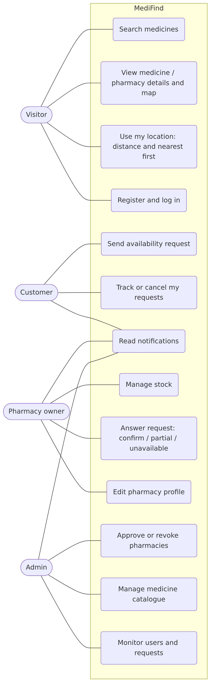

Figure 4.1: Use cases of the four kinds of user.

### 4.2 Architecture
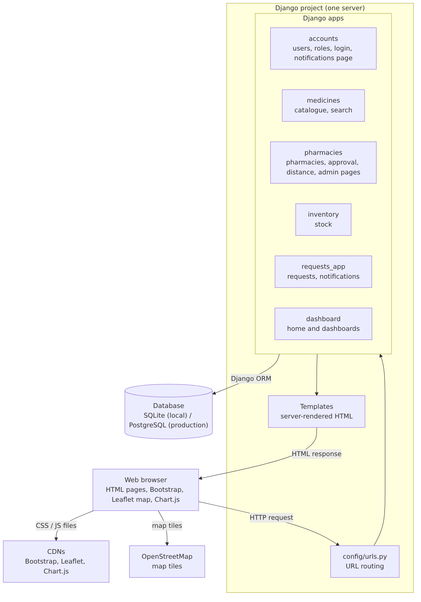

Figure 4.2: System architecture. The browser sends an HTTP request; Django routes it to a view in one
of six apps; the view checks the user's role, calls a service for the business rules, reads or writes
the database through Django's ORM, and returns an HTML page. CSS/JS libraries and map tiles are
loaded by the browser from CDNs and OpenStreetMap.

| App | Responsibility |
|---|---|
| accounts | Users, roles, registration, login, profile, notifications page |
| medicines | Medicine catalogue and search |
| pharmacies | Pharmacies, approval and its history, distance calculation, admin pages |
| inventory | Stock of each medicine at each pharmacy |
| requests_app | Availability requests and notifications |
| dashboard | Home page and the three dashboards |

### 4.3 Database design
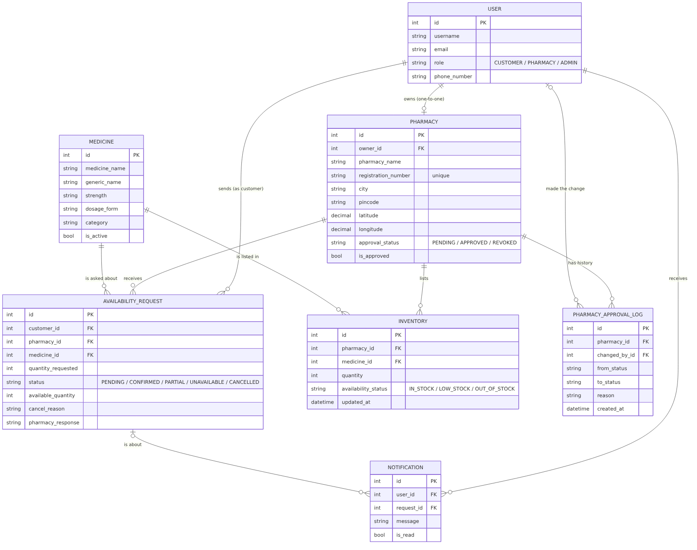

Figure 4.3: Entity-relationship diagram (7 tables).

| Table | Purpose |
|---|---|
| User | All accounts, with a role (customer, pharmacy owner, admin) |
| Pharmacy | One pharmacy per owner, with address, pincode, coordinates and approval status |
| PharmacyApprovalLog | History of approval changes: who, when, from/to status, reason |
| Medicine | The shared medicine catalogue |
| Inventory | Quantity of one medicine at one pharmacy, with automatic stock status and last update time |
| AvailabilityRequest | A customer's question to a pharmacy and the pharmacy's answer |
| Notification | In-app messages to users |

Important constraints: a pharmacy lists each medicine only once; the licence number is unique; a
pharmacy or medicine that has requests cannot be deleted, so the request history is kept.

### 4.4 Request flow
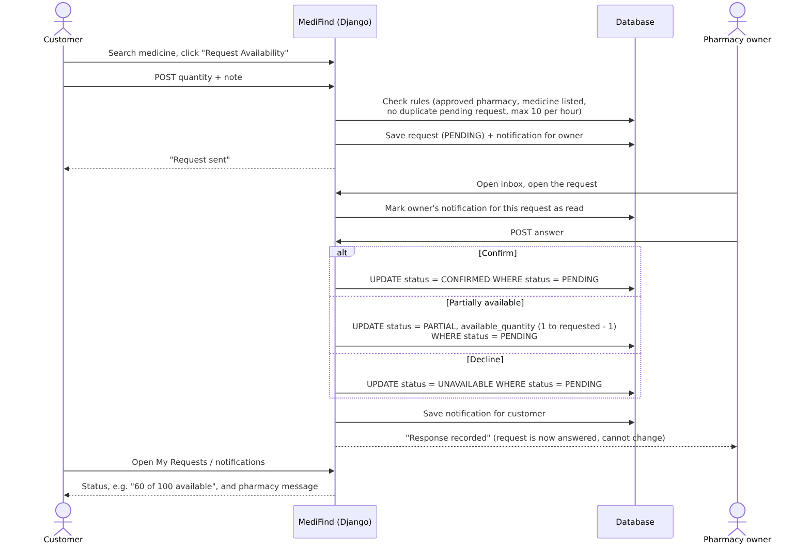

Figure 4.4: A customer sends a request, the owner answers once, the customer is notified.

### 4.5 Pharmacy approval
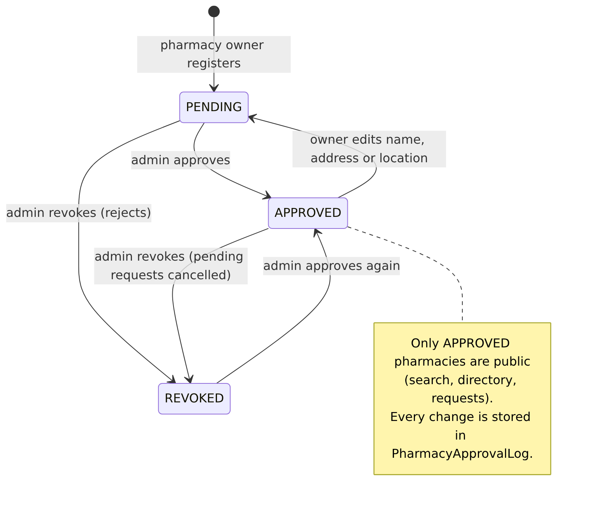

Figure 4.5: Approval states of a pharmacy. Only approved pharmacies are public.

---

## Chapter 5. Implementation

### 5.1 Technology stack
| Layer | Technology | Why |
|---|---|---|
| Language | Python 3.11 | Readable, large ecosystem |
| Web framework | Django 5.2 | Built-in login, admin, ORM, forms and security features |
| Database | SQLite (local), PostgreSQL (production) | No setup locally; robust in production |
| Front end | Django templates, Bootstrap 5, Bootstrap Icons | Server-rendered pages that work on phones |
| Maps | Leaflet with OpenStreetMap tiles | Free and open map data |
| Charts | Chart.js | Simple charts on the dashboards |
| Testing | Django test framework, Playwright with pytest | Unit tests and real browser tests |
| Deployment | Gunicorn, WhiteNoise, Render (`render.yaml`) | Simple cloud deployment |

### 5.2 Code structure
Every app has `models.py` (tables), `urls.py` (addresses), `views.py` (request handling and role
check), `services.py` (business rules), `forms.py` (input validation) and HTML templates. Keeping the
rules in services makes them easy to test.

### 5.3 Search
The search starts from stock rows of approved pharmacies and active medicines, applies the text search
(name, generic name, strength, form, category, description, pharmacy name) and the filters, and sorts
by a stock rank: In Stock, then Low Stock, then Out of Stock, and within each group the most recently
updated first. Results are paginated (10 per page) in the database.

### 5.4 Distance (Haversine formula)
The straight-line distance *d* between the user (φ1, λ1) and a pharmacy (φ2, λ2), in radians, on a
sphere of radius R = 6371 km:

```
a = sin²((φ2 − φ1) / 2) + cos φ1 · cos φ2 · sin²((λ2 − λ1) / 2)
d = 2 · R · asin(√a)
```

The formula is written once in Python and once as a database expression, so the database can filter by
radius and sort by distance before paginating. A quick latitude/longitude box removes far-away
pharmacies first. The user's location is taken from the browser only after permission and is not stored.

### 5.5 Stock status and freshness
When stock is saved, the status is set automatically: more than 10 units = In Stock, 1–10 = Low Stock,
0 = Out of Stock. The time since the last update decides the wording: within 24 hours, 24–48 hours, or
over 48 hours ("confirm before visiting").

### 5.6 Pharmacy approval
A new pharmacy starts as Pending and is not public. The admin approves or revokes it with separate
buttons; clicking twice changes nothing. Revoking cancels the pharmacy's pending requests and notifies
the customers. If an approved pharmacy changes its name, address or location, it goes back to Pending.
Every change is stored in the approval history with who, when and an optional reason.

### 5.7 Availability requests
Before a request is saved, the system checks that the pharmacy is approved and lists the medicine, that
the customer has no other pending request for the same medicine there, and that the customer has sent
fewer than 10 requests in the last hour. The answer is saved with a conditional update
("change only if the status is still pending"), so a request is answered only once, and an answer and a
cancellation at the same moment cannot overwrite each other. A partial answer stores how many units are
available (between 1 and the requested quantity minus 1).

### 5.8 Security
Role decorators protect every page; private data is always looked up together with its owner, so
another user's data gives "not found". Forms use CSRF tokens; data-changing actions accept only POST.
Map popups insert text safely to prevent script injection. Repeated failed logins are blocked for 15
minutes. Production settings are safe by default (HTTPS, secure cookies, no debug pages).

[TODO: add short code excerpts if your university asks for them, for example the Haversine function
in `pharmacies/services.py` and the answer logic in `requests_app/services.py`.]

---

## Chapter 6. Testing

### 6.1 Approach
- **Unit and integration tests** (197 tests in 17 files) use Django's test client to call pages and
  check the responses and the database.
- **Browser tests** (70 tests in 7 files) start the real application on a temporary database and use
  Playwright to click through it in Chromium like a user. A test fails on any browser console error or
  unexpected error response.
- **Lint** with ruff, and a GitHub Actions workflow that runs everything on every push.

### 6.2 Sample test cases
| ID | Test case | Expected result | Result |
|---|---|---|---|
| T1 | Search "Dolo" | Only approved pharmacies, In Stock first | Pass |
| T2 | Search with location and 5 km radius | Only pharmacies within 5 km, nearest first | Pass |
| T3 | Customer requests a medicine the pharmacy does not list | Request refused with a message | Pass |
| T4 | Second pending request for the same medicine and pharmacy | Refused | Pass |
| T5 | Owner answers a request twice | Second answer refused | Pass |
| T6 | Owner answers "partially available" with 60 of 100 | Customer sees "60 of 100 available" | Pass |
| T7 | Owner opens another pharmacy's stock or request by URL | 404 Not Found | Pass |
| T8 | Customer opens an admin page | Redirected with a message | Pass |
| T9 | Admin revokes a pharmacy with pending requests | Requests cancelled, customers notified, reason shown | Pass |
| T10 | Pharmacy name contains HTML/script code | Shown as text on maps, never run | Pass |
| T11 | Six wrong passwords for one account | Blocked with HTTP 429 | Pass |

### 6.3 Results
All 197 unit tests and all 70 browser tests passed on 2026-11-26. Manual testing found seven more
issues (for example the map tiles were refused by OpenStreetMap and cancelled requests showed the wrong
reason); all were fixed and covered by new tests. [TODO: add your own manual testing notes, devices
and browsers you tried.]

---

## Chapter 7. Results

| Figure | Screen |
|---|---|
| 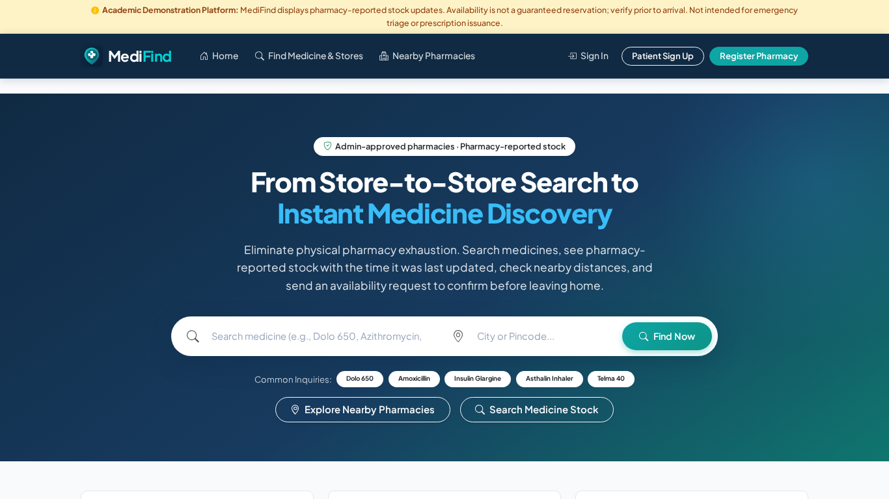 | 7.1 Home page |
| 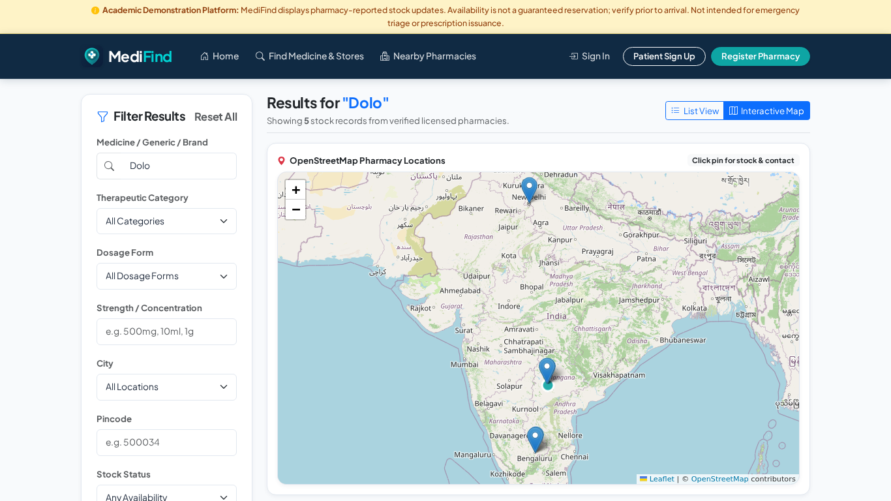 | 7.2 Search results on the map |
| 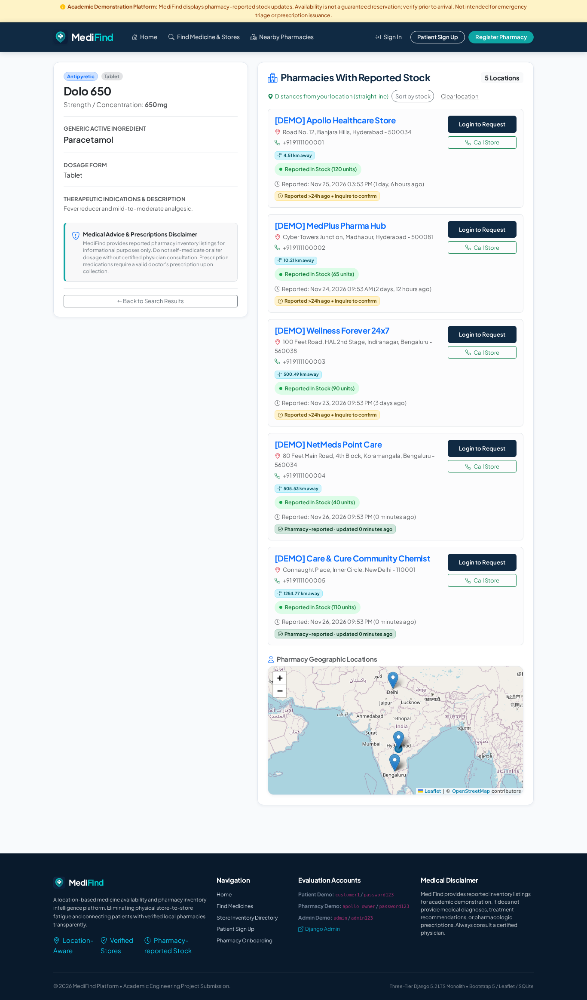 | 7.3 Medicine page with distances |
| 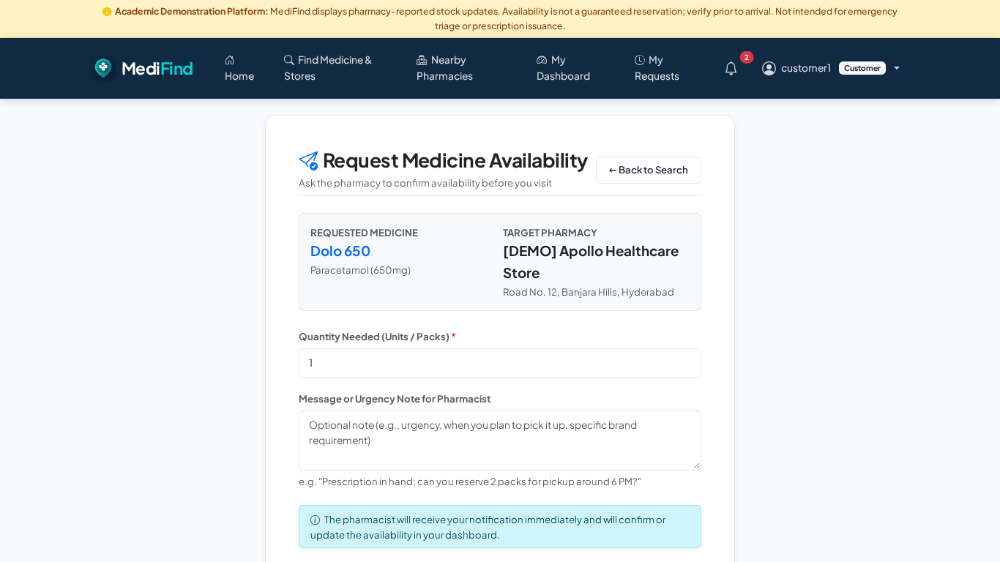 | 7.4 Customer request form |
| 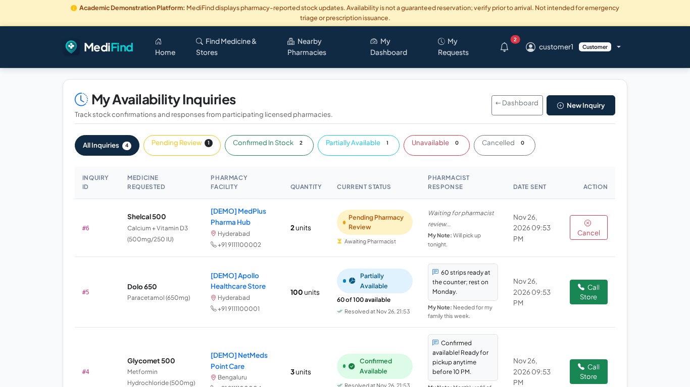 | 7.5 My Requests with a partial answer |
| 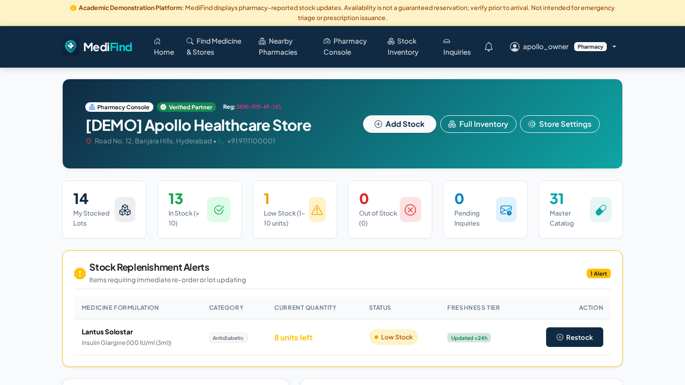 | 7.6 Pharmacy dashboard |
| 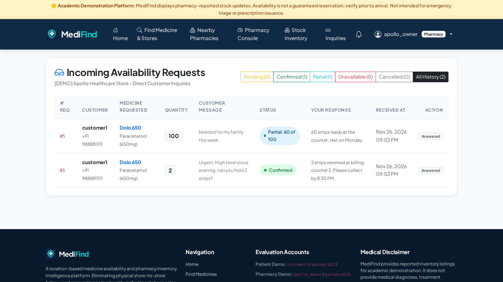 | 7.7 Pharmacy request inbox |
| 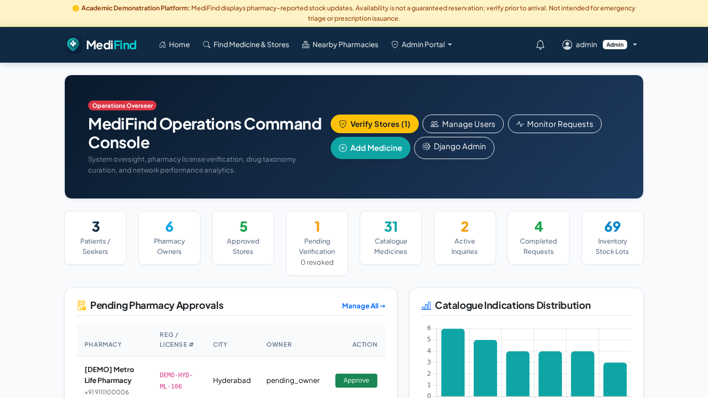 | 7.8 Admin dashboard |
| 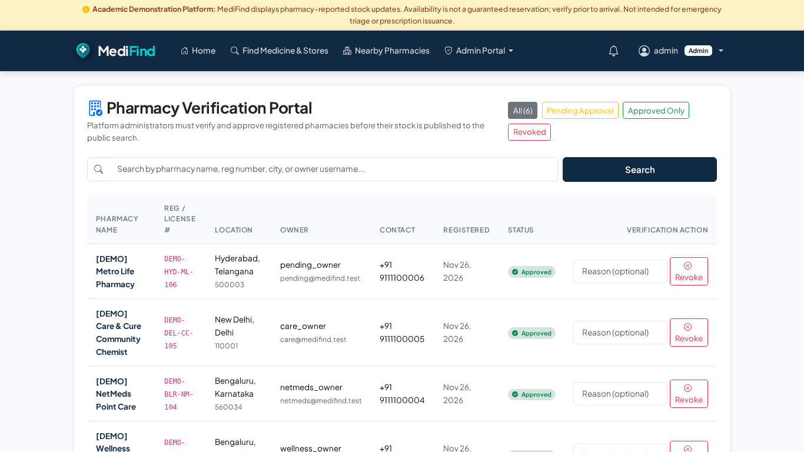 | 7.9 Pharmacy verification |
| 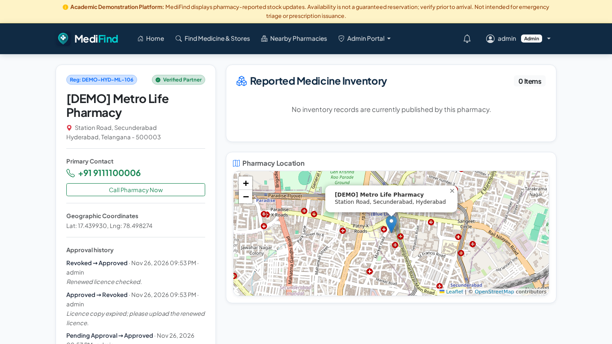 | 7.10 Approval history |
| 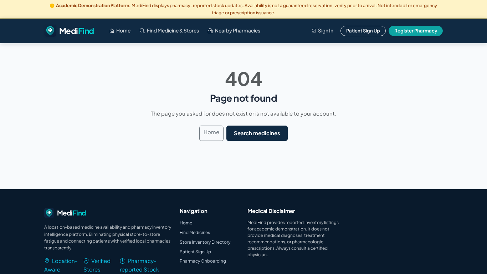 | 7.11 Page not found |

[TODO: in the Word/PDF report, put each screenshot on its own line with a caption and one or two
sentences explaining what it shows.]

---

## Chapter 8. Limitations, future work and conclusion

### 8.1 Limitations
- Stock is reported by the pharmacy; the system cannot check it, and a result is not a reservation.
- Stock changes only when the owner updates it (no automatic sync).
- Distance is a straight line, not road distance; pharmacies without coordinates have no distance.
- Notifications are in-app only.
- The login rate limit works per server process.
- No payment, ordering, reservation, prescription upload or mobile app.

### 8.2 Future work
- Connect to pharmacy billing software for automatic stock updates.
- Email or SMS alerts when a request is answered or a medicine is back in stock.
- Road distance and directions; an installable mobile app.
- Stock history and expiry dates; a shared cache for the rate limit.

### 8.3 Conclusion
MediFind shows that a simple web application can connect patients with nearby pharmacies and save
them unnecessary travel and phone calls. Pharmacies keep control of their own data, an administrator
keeps fake pharmacies out, and every result says how old it is. The project met its objectives:
search with distance and maps, requests answered once with partial availability, role-based security,
and a large automated test suite. [TODO: your personal conclusion and what you learned.]

---

## References
[TODO: list only sources you actually used, in your university's style. Typical ones for this project:]
1. Django documentation, https://docs.djangoproject.com/
2. Leaflet documentation, https://leafletjs.com/
3. OpenStreetMap tile usage policy, https://operations.osmfoundation.org/policies/tiles/
4. Bootstrap documentation, https://getbootstrap.com/
5. Playwright for Python documentation, https://playwright.dev/python/

## Appendix
- A. How to run the project: `python scripts/setup.py` (Windows: `py scripts\setup.py`), then
  `runserver`; details in the project [README](../README.md).
- B. User guide: [USER_GUIDE.md](USER_GUIDE.md).
- C. Full test list: [TESTING.md](TESTING.md).
